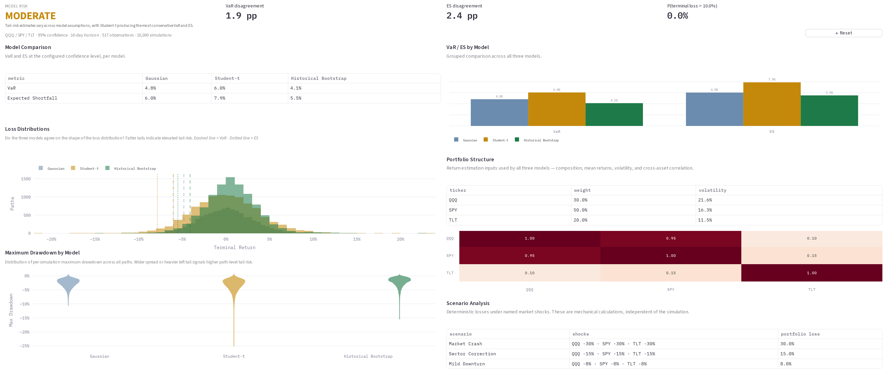
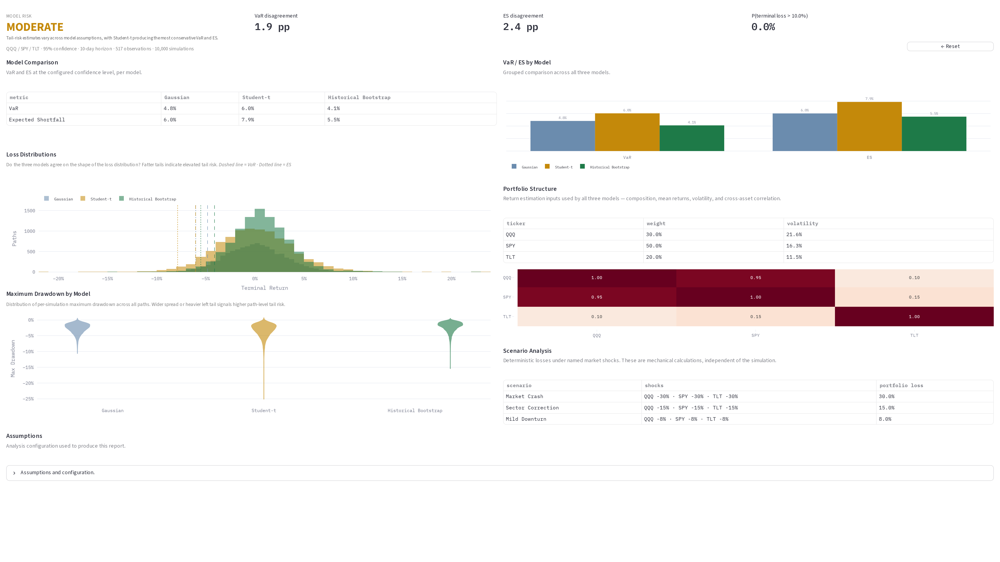

# Portfolio Risk Lab

A portfolio risk analysis tool that compares Gaussian, Student-t, and historical-bootstrap simulations to measure how model assumptions change VaR, Expected Shortfall, and drawdown estimates.

> The gap between the most and least conservative model is itself a risk signal. This tool makes that gap visible.

---

## Overview

Standard risk models produce a single VaR or ES figure and present it as the answer. The number depends heavily on assumptions about the return distribution — assumptions that are rarely disclosed and rarely tested.

Portfolio Risk Lab runs three simulation models simultaneously on the same portfolio and compares their outputs. The spread between models — the **model risk** — is reported as a diagnostic in its own right.

The tool also runs deterministic stress scenarios (user-defined asset shocks) and computes portfolio-level loss for each.

---

## Why This Matters

A Gaussian model assumes returns are normally distributed. In practice, equity returns have fat tails: large moves happen more often than the Gaussian model predicts. A Student-t model accounts for this. A historical bootstrap makes no distributional assumption at all — it resamples from the actual observed return history.

If these three models produce similar VaR estimates, the risk number is robust to distributional assumptions. If they diverge materially, the risk number is sensitive to a modelling choice that has no objectively correct answer.

That divergence is model risk. Reporting a single VaR without acknowledging it is a form of false precision.

---

## Key Features

- **Three simulation models** — Gaussian, Student-t (fat tails), and historical bootstrap (non-parametric)
- **Side-by-side risk comparison** — VaR and Expected Shortfall for each model at a configurable confidence level
- **Model risk verdict** — HIGH / MODERATE / LOW based on the spread between model outputs
- **Drawdown distribution** — per-model violin chart of simulated maximum drawdowns across 10,000 paths
- **Loss distribution overlay** — three loss distributions plotted on a single chart for direct comparison
- **Stress scenario analysis** — deterministic asset-shock scenarios with portfolio-level loss calculation
- **Correlation heatmap** — estimated correlation structure from the return history

---

## Example Result

**Demo:** QQQ 30% / SPY 50% / TLT 20% · 95% confidence · 10-day horizon · 10,000 simulations

| Model | VaR | Expected Shortfall |
|---|---|---|
| Gaussian | 4.2% | 6.0% |
| Student-t | 6.1% | 8.4% |
| Historical Bootstrap | 4.2% | 6.0% |

- VaR range across models: **1.9 percentage points**
- ES range across models: **2.4 percentage points**
- P(terminal loss > 10%) across models: **0.0%** at a 10-day horizon

**Model Risk: MODERATE**

Models diverge on tail estimates, with Student-t producing the most conservative VaR and ES. The spread signals meaningful model uncertainty at the tail, though all three models agree that a 10-day terminal loss exceeding 10% is near-zero probability for this portfolio.

---

## Screenshots

### Model risk summary



### Loss distribution comparison



---

## How It Works

```text
Portfolio CSV (tickers + weights)
  ↓
Price fetching (yfinance) + return estimation
  ↓
Parallel simulation (Gaussian / Student-t / Historical Bootstrap)
  ↓
Risk measurement (VaR, ES, drawdown, loss probability)
  ↓
Model comparison + model risk verdict
  ↓
Diagnostic report (charts + scenario analysis + assumptions)
```

**Return estimation** fits a covariance matrix and per-asset volatility and mean from the historical return series. Correlation structure is preserved across all models.

**Gaussian simulation** draws returns from a multivariate normal distribution parameterised by the estimated mean and covariance.

**Student-t simulation** draws from a multivariate Student-t distribution with configurable degrees of freedom. Lower degrees of freedom produce heavier tails.

**Historical bootstrap** resamples return vectors (preserving cross-asset correlation on each day) with replacement. No distributional assumption is made.

**Risk measurement** computes VaR and ES from the terminal return distribution of each simulation. Drawdown is computed across all simulated paths.

**Model comparison** reports the spread between the most and least conservative model for VaR and ES. The verdict is determined by the magnitude of that spread.

---

## Methodology

### Simulation Models

#### Gaussian

Multivariate normal simulation. Parameterised by the sample mean vector and sample covariance matrix estimated from the supplied return history. Assumes returns are elliptically distributed with no excess kurtosis.

This model systematically underestimates tail risk for equity portfolios.

#### Student-t

Multivariate Student-t simulation. The scale matrix is calibrated from the same historical covariance estimate. At low degrees of freedom, the effective variance is inflated relative to the Gaussian model — at df=5, by a factor of 1.67. At high degrees of freedom (> 30), the Student-t converges to the Gaussian.

#### Historical Bootstrap

Resamples full-portfolio daily return vectors from the observed history with replacement. Preserves the empirical joint distribution, including fat tails, skewness, and the cross-sectional dependence structure present in sampled return vectors. Makes no distributional assumption.

### Risk Measures

**Value at Risk (VaR)** is the loss level not exceeded with the specified confidence (e.g. 95%). It answers: what is the threshold below which 95% of simulated outcomes fall?

**Expected Shortfall (ES)** is the mean loss conditional on the loss exceeding the VaR threshold. It answers: given that we are in the worst 5% of outcomes, what is the average loss?

ES is more informative than VaR for tail risk because it captures the severity of extreme losses, not just their threshold.

### Model Risk Verdict

The model risk verdict is determined by the range of VaR and ES estimates across the three models:

- **LOW** — models agree within a narrow band; distributional assumptions are not material
- **MODERATE** — models diverge; risk limits should account for model uncertainty
- **HIGH** — models diverge materially; the risk number is sensitive to assumptions that cannot be resolved from the data

---

## Tech Stack

- Python 3.12
- pandas, NumPy, SciPy
- yfinance (price fetching)
- Plotly
- Streamlit

---

## Running Locally

### 1. Clone

```bash
git clone https://github.com/<username>/portfolio-risk-lab.git
cd portfolio-risk-lab
```

### 2. Install dependencies

```bash
pip install uv
uv sync --extra dev
```

### 3. Run

```bash
uv run streamlit run streamlit_app.py
```

---

## Input Format

### Portfolio CSV

| Column | Description |
|---|---|
| `ticker` | Asset ticker symbol (e.g. `SPY`, `QQQ`) |
| `weight` | Portfolio weight as a decimal (e.g. `0.4` for 40%) |

Weights must sum to 1.0. A sample file is included at `examples/portfolio_spy_qqq_tlt.csv`.

The tool fetches historical prices automatically from yfinance using the tickers in the CSV.

---

## Project Structure

```text
.
├── streamlit_app.py        # Entry point
├── app/
│   ├── dashboard.py        # Streamlit rendering layer
│   ├── orchestrator.py     # Orchestrator wiring
│   └── validation.py       # UI-level input validation
├── src/
│   ├── domain.py           # Domain types
│   ├── pipeline/           # End-to-end analysis pipeline
│   ├── portfolio/          # CSV loading and canonicalisation
│   ├── returns/            # Return estimation, covariance, correlation
│   ├── simulation/         # Gaussian, Student-t, bootstrap simulators
│   ├── risk/               # VaR, ES, drawdown, loss probability
│   ├── scenarios/          # Stress scenario engine
│   └── diagnostics/        # Model comparison, findings, verdict
├── tests/
├── examples/
│   └── portfolio_spy_qqq_tlt.csv
└── pyproject.toml
```

---

## Testing

```bash
uv run pytest
```

Tests cover:

- VaR and ES calculation correctness against known analytical values
- Simulation reproducibility under fixed random seeds
- Model comparison logic and verdict thresholds
- Portfolio validation rules (weight sum, missing tickers)
- Scenario loss calculation
- Dashboard rendering contracts (no analytical code in the UI layer)

---

## Reproducibility

All simulations use a configurable random seed (default: 42). With the same portfolio, the same configuration, and the same seed, the diagnostic report is fully reproducible.

The sample portfolio at `examples/portfolio_spy_qqq_tlt.csv` can be used to reproduce the demo result above.

---

## Limitations & Assumptions

- Price data is fetched from yfinance. Results depend on the availability and quality of that data.
- The historical bootstrap assumes the future return distribution resembles the observed history. Structural breaks are not modelled.
- Simulation assumes daily returns are i.i.d. (no serial autocorrelation or volatility clustering). The Gaussian and Student-t models do not capture GARCH-type dynamics.
- Scenario shocks are applied as deterministic percentage changes. Contagion and second-order effects are not modelled.
- This tool is a risk analysis instrument, not a portfolio optimiser and not a trading system.
- Results do not constitute investment advice.

---

## Possible Extensions

- GARCH-based volatility simulation
- Factor model decomposition (market / sector / idiosyncratic)
- Multi-period scenario paths (rather than point-in-time shocks)

---

## Disclaimer

This software is provided for research and educational purposes only. It does not constitute investment advice.
